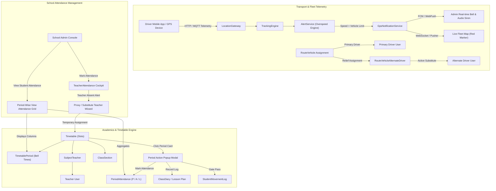

# Zolo SmartSchool — Transport, Attendance & Timetable Implementation Specification

**Document Version:** 2.0.0  
**Target Repository:** `nandha3d/zolo-smartschool`  
**Target Platform:** Laravel 10 (Multi-Tenant SaaS), MySQL, Blade, Bootstrap Table, FullCalendar, Flutter Apps  
**Scope:** 7 Core Modules (GPS Speed Alerts, Route & Stop Customization, Alternate Drivers, Teacher Attendance by Admin, Period View Attendance, Teacher Timetable Action Popup, and Timetable Time/Period Alignment)  
**Author / Architect:** Google DeepMind / Antigravity Agentic Engineering  
**Date:** October 30, 2026  

---

## 1. Executive Summary & Traceability Matrix

This specification provides the production-grade architectural blueprint, database migrations, backend services, controller implementations, Blade UI layouts, and JavaScript modules required to deliver seven interconnected operational enhancements across **Transport Management**, **Attendance Management**, and the **Timetable System**.

### Requirement Traceability Matrix

| ID | User Requirement | Primary Subsystems | Key Deficiencies in Existing Code | Target Deliverables |
|:---|:---|:---|:---|:---|
| **REQ-1** | **GPS Speed Tracking & Admin Intimation** | `GpsTransport Addon`, Telemetry Ingestion, Alert Engine, WebSocket, FCM | Overspeed is hardcoded to `45 km/h` in static config; no per-vehicle/per-school threshold; no real-time audio-visual admin intimation; no live fleet map alert badge. | Dynamic speed limit in `vehicles` table; audio siren & topbar bell alert; FCM admin dispatch; live map flashing red speed marker; incident acknowledgment modal. |
| **REQ-2** | **Transport Route & Stops Customization** | `RouteController`, `PickupPointController`, Leaflet / Google Maps API | Route stops only have static arrival/departure times in a repeater; no map geofence; cannot define independent morning pickup vs afternoon drop sequences; no polyline waypoint snapping. | Interactive Route Builder on OpenStreetMap/Leaflet; stop-level geofence radius & wait buffer; split sequence for Morning Pick vs Afternoon Drop; polyline road route snapping. |
| **REQ-3** | **Driver Management — Alternate Drivers** | `RouteVehicle`, `DriverHelperController`, Driver Mobile API | `RouteVehicle` only holds a single static `driver_id`; when driver is sick/on leave, route vehicle assignment breaks; no roster audit or mobile app authorization for relief drivers. | `route_vehicle_drivers` roster model; primary vs alternate/relief drivers; 1-click substitute handover; mobile app GPS auth token sync; parent push notice of driver change. |
| **REQ-4** | **Teachers Attendance by Admin** | `StaffAttendanceController`, Timetable Integration, Substitution Engine | Teachers are lumped into generic staff attendance without faculty distinction; no timetable conflict check; missing teacher absence does not trigger proxy/substitute teacher alerts. | Dedicated Teacher Attendance Cockpit; Department/Subject filters; 1-click daily status (P, A, HD, OD, CL, ML); automated Timetable Impact Analyzer & Proxy Teacher Assign wizard. |
| **REQ-5** | **View Attendance Filter Fix & Period Matrix View** | `AttendanceController`, `attendance/view.blade.php`, `PeriodAttendance` | `#timetable_class_section` change event is missing from JS listener (table doesn't refresh); no persistent default filter; displays flat list instead of a Period-by-Period student matrix. | Fix filter event binding; retain default class section & date via `localStorage`; build Period-Wise Matrix View: Columns = Period 1 to N with time; Cells = Green `P` & Red `A` badges. |
| **REQ-6** | **Teacher Timetable Period Eligibility & Action Submenu** | `TimetableController`, `PeriodAttendanceController`, Teacher Portal | Any teacher or admin could view/mark any period without assignment eligibility check; timetable cards are static and non-interactive; cannot launch period attendance from timetable. | Strict teacher assignment authorization check; timetable period click trigger; Action Submenu popup: Mark Period Attendance, Class Diary / Lesson Plan, Student Manifest, Gate Pass. |
| **REQ-7** | **Timetable Alignment & Time Slot Mismatch Fix** | `custom.js`, FullCalendar, `timetable/teacher/view.blade.php` | FullCalendar `timeGridWeek` uses fixed continuous 45m slots without break awareness; recess/lunch breaks push cards 15m out of phase; cards float across grid lines (Image 3 defect). | Fixed Period-Grid Matrix Architecture; dynamic 15-minute GCD slot snapping; background break blocks (`Recess`, `Lunch`); eliminates card drift and column overlap. |

---

## 2. Global Architecture & Data Relationships



---

## 3. Module 1: GPS Speed Tracking & Instant Admin Intimation

### 3.1 Problem Statement & Architectural Flaws
In the current code (`PHP_CODE/app/Addons/GpsTransport/Services/AlertService.php`):
- Speed threshold is hardcoded via `config('gpstransport.defaults.speed_limit_kmh', 45.0)`. Different vehicles (e.g., vans vs 50-seater buses vs city buses) require distinct speed thresholds.
- Alerts are written to `gps_alerts` but no interactive browser alert (audio siren, high-priority dashboard banner, or live map indicator) informs the school administrator when an incident occurs.
- No incident workflow exists to allow admins to call the driver, log an official warning, or acknowledge the breach.

### 3.2 Database Migration: Configurable Speed Limit & Enhanced Alerts

File path: `database/migrations/schools/2026_10_30_000001_add_speed_limit_and_alert_workflow_tables.php`

```php
<?php

use Illuminate\Database\Migrations\Migration;
use Illuminate\Database\Schema\Blueprint;
use Illuminate\Support\Facades\Schema;

return new class extends Migration {
    public function up(): void
    {
        // 1. Add configurable speed limit and emergency contact to vehicles table
        Schema::table('vehicles', function (Blueprint $table) {
            if (!Schema::hasColumn('vehicles', 'speed_limit_kmh')) {
                $table->decimal('speed_limit_kmh', 5, 2)->default(40.00)->after('capacity');
            }
            if (!Schema::hasColumn('vehicles', 'speed_alert_cooldown_minutes')) {
                $table->integer('speed_alert_cooldown_minutes')->default(3)->after('speed_limit_kmh');
            }
        });

        // 2. Enhance gps_alerts for Admin Incident Management
        Schema::table('gps_alerts', function (Blueprint $table) {
            if (!Schema::hasColumn('gps_alerts', 'peak_speed')) {
                $table->decimal('peak_speed', 5, 2)->nullable()->after('speed');
            }
            if (!Schema::hasColumn('gps_alerts', 'duration_seconds')) {
                $table->integer('duration_seconds')->default(0)->after('peak_speed');
            }
            if (!Schema::hasColumn('gps_alerts', 'driver_id')) {
                $table->unsignedBigInteger('driver_id')->nullable()->after('vehicle_id');
            }
            if (!Schema::hasColumn('gps_alerts', 'route_id')) {
                $table->unsignedBigInteger('route_id')->nullable()->after('driver_id');
            }
            if (!Schema::hasColumn('gps_alerts', 'acknowledged_by_user_id')) {
                $table->unsignedBigInteger('acknowledged_by_user_id')->nullable()->after('is_resolved');
            }
            if (!Schema::hasColumn('gps_alerts', 'acknowledged_at')) {
                $table->timestamp('acknowledged_at')->nullable()->after('acknowledged_by_user_id');
            }
            if (!Schema::hasColumn('gps_alerts', 'admin_remarks')) {
                $table->text('admin_remarks')->nullable()->after('acknowledged_at');
            }
        });
    }

    public function down(): void
    {
        Schema::table('vehicles', function (Blueprint $table) {
            $table->dropColumn(['speed_limit_kmh', 'speed_alert_cooldown_minutes']);
        });
        Schema::table('gps_alerts', function (Blueprint $table) {
            $table->dropColumn([
                'peak_speed', 'duration_seconds', 'driver_id',
                'route_id', 'acknowledged_by_user_id', 'acknowledged_at', 'admin_remarks'
            ]);
        });
    }
};
```

### 3.3 Backend Speed Tracking & Alert Service Update

Update `PHP_CODE/app/Addons/GpsTransport/Services/AlertService.php` to evaluate against dynamic vehicle limits and fire instant notifications:

```php
<?php

namespace App\Addons\GpsTransport\Services;

use App\Addons\GpsTransport\DTO\NormalizedLocation;
use App\Addons\GpsTransport\Models\GpsAlert;
use App\Addons\GpsTransport\Models\GpsTrip;
use App\Models\Vehicle;
use App\Events\GpsSpeedViolationEvent;
use Carbon\Carbon;
use Illuminate\Support\Facades\Cache;
use Illuminate\Support\Facades\Log;

class AlertService
{
    private GpsNotificationService $notificationService;

    public function __construct(GpsNotificationService $notificationService)
    {
        $this->notificationService = $notificationService;
    }

    public function evaluate(NormalizedLocation $location, ?GpsTrip $trip, array $deviationInfo = []): array
    {
        $alertsGenerated = [];

        // 1. Resolve vehicle-specific speed limit
        $vehicle = Vehicle::find($location->vehicleId);
        $speedLimit = (float) ($vehicle?->speed_limit_kmh ?? config('gpstransport.defaults.speed_limit_kmh', 40.0));
        $overspeedToleranceSeconds = (int) config('gpstransport.defaults.overspeed_duration_seconds', 5); // 5 sec sustained trigger

        if ($location->speed > $speedLimit) {
            $cacheKey = "gps_overspeed_start_{$location->vehicleId}";
            $peakKey = "gps_overspeed_peak_{$location->vehicleId}";
            
            $firstSeen = Cache::get($cacheKey);
            $currentPeak = (float) Cache::get($peakKey, $location->speed);
            if ($location->speed > $currentPeak) {
                Cache::put($peakKey, $location->speed, 300);
                $currentPeak = $location->speed;
            }

            if (!$firstSeen) {
                Cache::put($cacheKey, Carbon::now()->timestamp, 300);
            } else {
                $duration = Carbon::now()->timestamp - (int) $firstSeen;
                if ($duration >= $overspeedToleranceSeconds) {
                    $alert = $this->createSpeedAlert(
                        $trip,
                        $vehicle,
                        $location,
                        $currentPeak,
                        $duration,
                        $speedLimit
                    );
                    if ($alert) {
                        $alertsGenerated[] = $alert;
                    }
                }
            }
        } else {
            Cache::forget("gps_overspeed_start_{$location->vehicleId}");
            Cache::forget("gps_overspeed_peak_{$location->vehicleId}");
        }

        return $alertsGenerated;
    }

    private function createSpeedAlert(
        ?GpsTrip $trip,
        ?Vehicle $vehicle,
        NormalizedLocation $location,
        float $peakSpeed,
        int $duration,
        float $speedLimit
    ): ?GpsAlert {
        $cooldownMinutes = $vehicle?->speed_alert_cooldown_minutes ?? 3;
        $debounceKey = "gps_speed_alert_debounce_{$location->vehicleId}";

        if (Cache::has($debounceKey)) {
            return null; // Debounce active
        }

        try {
            $alert = GpsAlert::create([
                'trip_id'          => $trip?->id,
                'vehicle_id'       => $location->vehicleId,
                'driver_id'        => $trip?->driver_id,
                'route_id'         => $trip?->route_id,
                'alert_type'       => 'OVERSPEED',
                'severity'         => 'CRITICAL',
                'message'          => "Bus {$vehicle?->vehicle_number} running at {$location->speed} km/h (Peak: {$peakSpeed} km/h), exceeding limit of {$speedLimit} km/h for {$duration}s",
                'latitude'         => $location->latitude,
                'longitude'        => $location->longitude,
                'speed'            => $location->speed,
                'peak_speed'       => $peakSpeed,
                'duration_seconds' => $duration,
                'is_resolved'      => false,
            ]);

            Cache::put($debounceKey, true, $cooldownMinutes * 60);

            // 1. Dispatch Multi-Channel FCM Notification to School Admin
            $this->notificationService->sendSafetyAlertNotification($alert);

            // 2. Broadcast Real-Time WebSocket Event for Instant Admin UI Notification & Siren
            broadcast(new GpsSpeedViolationEvent($alert))->toOthers();

            return $alert;
        } catch (\Throwable $e) {
            Log::error("Failed to create speed alert: {$e->getMessage()}");
            return null;
        }
    }
}
```

### 3.4 Live Admin Audio-Visual Intimation (Blade & JavaScript)

Add to `PHP_CODE/resources/views/layouts/master.blade.php` (or topbar notification drawer):

```html
<!-- Admin Real-Time GPS Speed Alert Toast & Siren Audio Element -->
<audio id="speedAlertSiren" preload="auto">
    <source src="{{ asset('assets/audio/bus-overspeed-alarm.mp3') }}" type="audio/mpeg">
</audio>

<div id="liveSpeedAlertModal" class="modal fade zolo-compact-modal" tabindex="-1" role="dialog" data-backdrop="static">
    <div class="modal-dialog modal-dialog-centered" role="document">
        <div class="modal-content border-danger shadow-lg">
            <div class="modal-header bg-danger text-white py-2">
                <h5 class="modal-title font-weight-bold d-flex align-items-center">
                    <i class="fa fa-exclamation-triangle mr-2"></i> CRITICAL: VEHICLE OVERSPEED INTIMATION
                </h5>
                <button type="button" class="close text-white" onclick="dismissSpeedAlarm()">&times;</button>
            </div>
            <div class="modal-body text-center p-3">
                <div class="mb-2">
                    <span class="badge badge-danger p-2 font-weight-bold" style="font-size: 20px;" id="alertCurrentSpeed">
                        0.0 km/h
                    </span>
                    <span class="text-muted ml-2">(Allowed: <span id="alertSpeedLimit">0</span> km/h)</span>
                </div>
                <h6 class="font-weight-bold text-dark" id="alertVehicleInfo">Vehicle #</h6>
                <p class="text-muted mb-2" id="alertDriverInfo">Driver: </p>
                <div class="p-2 rounded bg-light mb-3 text-left" style="font-size: 13px;">
                    <div><strong>Route:</strong> <span id="alertRouteName">-</span></div>
                    <div><strong>Location:</strong> <span id="alertLocationCoordinates">-</span></div>
                    <div><strong>Time:</strong> <span id="alertTimestamp">-</span></div>
                </div>
                <div class="d-flex justify-content-center gap-2">
                    <a href="#" id="callDriverBtn" class="btn btn-primary btn-sm">
                        <i class="fa fa-phone mr-1"></i> Call Driver
                    </a>
                    <a href="#" id="viewLiveMapBtn" class="btn btn-outline-danger btn-sm" target="_blank">
                        <i class="fa fa-map-marker mr-1"></i> View Live Map
                    </a>
                    <button type="button" class="btn btn-secondary btn-sm" onclick="acknowledgeSpeedAlert()">
                        <i class="fa fa-check mr-1"></i> Acknowledge
                    </button>
                </div>
            </div>
        </div>
    </div>
</div>

<script>
    // Listen on school fleet broadcast channel via Laravel Echo / Pusher
    if (typeof Echo !== 'undefined') {
        Echo.private('school-fleet-alerts.{{ Auth::user()->school_id ?? 1 }}')
            .listen('.GpsSpeedViolationEvent', function(e) {
                let alertData = e.alert;
                
                // Play Siren Alarm
                let audio = document.getElementById('speedAlertSiren');
                if (audio) { audio.play().catch(err => console.log('Audio autoplay blocked')); }

                // Populate and trigger modal
                $('#alertCurrentSpeed').text(alertData.speed + ' km/h (Peak: ' + alertData.peak_speed + ' km/h)');
                $('#alertVehicleInfo').text('Bus ' + alertData.vehicle_number);
                $('#alertDriverInfo').text('Driver: ' + alertData.driver_name + ' (' + alertData.driver_phone + ')');
                $('#alertRouteName').text(alertData.route_name);
                $('#alertLocationCoordinates').text(alertData.latitude + ', ' + alertData.longitude);
                $('#alertTimestamp').text(alertData.created_at);
                $('#callDriverBtn').attr('href', 'tel:' + alertData.driver_phone);
                $('#viewLiveMapBtn').attr('href', '/transport/live-tracking?vehicle_id=' + alertData.vehicle_id);

                $('#liveSpeedAlertModal').modal('show');
            });
    }

    function dismissSpeedAlarm() {
        let audio = document.getElementById('speedAlertSiren');
        if (audio) { audio.pause(); audio.currentTime = 0; }
        $('#liveSpeedAlertModal').modal('hide');
    }

    function acknowledgeSpeedAlert() {
        dismissSpeedAlarm();
        // Submit AJAX acknowledgment
    }
</script>
```

---

## 4. Module 2: Transport Route and Stops Customization

### 4.1 Required Features & Capabilities
1. **Interactive Visual Stop Placement**: Admins click on OpenStreetMap / Leaflet to place stops, automatically populating latitude, longitude, and geofence radius.
2. **Independent Morning vs Afternoon Sequences**: In traditional schools, the morning bus collects from Point A -> Point B -> Point C -> School, whereas the afternoon bus drops School -> Point C -> Point B -> Point A. The system must support independent ordering and timings.
3. **Stop Parameters**:
   - Geofence detection radius (50m, 100m, 150m).
   - Average halting buffer time (minutes required for children to board/alight).
   - Landmark descriptions & emergency contact person per stop.
4. **Road Polyline Snapping**: Snapping stops to actual driving paths (via OSRM / Google Directions API) to calculate realistic travel distances and accurate ETAs.

### 4.2 Database Migration: Enhanced Route & Stops Schema

File path: `database/migrations/schools/2026_10_30_000002_enhance_route_and_pickup_points_tables.php`

```php
<?php

use Illuminate\Database\Migrations\Migration;
use Illuminate\Database\Schema\Blueprint;
use Illuminate\Support\Facades\Schema;

return new class extends Migration {
    public function up(): void
    {
        // 1. Enhanced Pickup Points
        Schema::table('pickup_points', function (Blueprint $table) {
            if (!Schema::hasColumn('pickup_points', 'latitude')) {
                $table->decimal('latitude', 10, 7)->nullable()->after('name');
            }
            if (!Schema::hasColumn('pickup_points', 'longitude')) {
                $table->decimal('longitude', 10, 7)->nullable()->after('latitude');
            }
            if (!Schema::hasColumn('pickup_points', 'geofence_radius_meters')) {
                $table->integer('geofence_radius_meters')->default(100)->after('longitude');
            }
            if (!Schema::hasColumn('pickup_points', 'halt_duration_minutes')) {
                $table->integer('halt_duration_minutes')->default(2)->after('geofence_radius_meters');
            }
            if (!Schema::hasColumn('pickup_points', 'landmark')) {
                $table->string('landmark', 255)->nullable()->after('halt_duration_minutes');
            }
        });

        // 2. Enhanced Route Pickup Points mapping with Morning & Afternoon sequence
        Schema::table('route_pickup_points', function (Blueprint $table) {
            if (!Schema::hasColumn('route_pickup_points', 'morning_order')) {
                $table->integer('morning_order')->default(1)->after('pickup_point_id');
            }
            if (!Schema::hasColumn('route_pickup_points', 'afternoon_order')) {
                $table->integer('afternoon_order')->default(1)->after('morning_order');
            }
            if (!Schema::hasColumn('route_pickup_points', 'is_active')) {
                $table->boolean('is_active')->default(true)->after('drop_time');
            }
        });

        // 3. Stored Polyline on Routes for Route Deviation Engine
        Schema::table('routes', function (Blueprint $table) {
            if (!Schema::hasColumn('routes', 'polyline_coordinates')) {
                $table->json('polyline_coordinates')->nullable()->after('distance');
            }
            if (!Schema::hasColumn('routes', 'start_landmark')) {
                $table->string('start_landmark', 255)->nullable()->after('polyline_coordinates');
            }
            if (!Schema::hasColumn('routes', 'end_landmark')) {
                $table->string('end_landmark', 255)->nullable()->after('start_landmark');
            }
        });
    }

    public function down(): void
    {
        Schema::table('pickup_points', function (Blueprint $table) {
            $table->dropColumn(['latitude', 'longitude', 'geofence_radius_meters', 'halt_duration_minutes', 'landmark']);
        });
        Schema::table('route_pickup_points', function (Blueprint $table) {
            $table->dropColumn(['morning_order', 'afternoon_order', 'is_active']);
        });
        Schema::table('routes', function (Blueprint $table) {
            $table->dropColumn(['polyline_coordinates', 'start_landmark', 'end_landmark']);
        });
    }
};
```

### 4.3 Interactive Visual Map Route Builder (Blade Component)

Add interactive Leaflet map to `PHP_CODE/resources/views/routes/create_interactive.blade.php`:

```html
<div class="row">
    <div class="col-md-7">
        <div id="routeMap" style="height: 520px; width: 100%; border-radius: 8px; border: 2px solid var(--zolo-border);"></div>
        <small class="text-muted"><i class="fa fa-info-circle"></i> Click on the map to add a new stop or drag existing pins to adjust coordinates.</small>
    </div>
    <div class="col-md-5">
        <div class="card h-100 shadow-sm">
            <div class="card-header bg-theme text-white py-2 d-flex justify-content-between align-items-center">
                <h6 class="mb-0 font-weight-bold">Stops & Sequences</h6>
                <button type="button" class="btn btn-xs btn-light text-dark font-weight-bold" onclick="autoReverseAfternoon()">
                    <i class="fa fa-exchange mr-1"></i> Auto-Reverse Afternoon
                </button>
            </div>
            <div class="card-body p-2" style="overflow-y: auto; max-height: 460px;">
                <ul id="sortableStopsList" class="list-group">
                    <!-- Dynamic Stop Items with Drag Handle -->
                </ul>
            </div>
        </div>
    </div>
</div>

<script>
    var map = L.map('routeMap').setView([11.0168, 76.9558], 13);
    L.tileLayer('https://{s}.tile.openstreetmap.org/{z}/{x}/{y}.png', { maxZoom: 19 }).addTo(map);

    var stopMarkers = [];

    map.on('click', function(e) {
        let lat = e.latlng.lat.toFixed(6);
        let lng = e.latlng.lng.toFixed(6);
        addStopToRoute(lat, lng, 'Stop #' + (stopMarkers.length + 1));
    });

    function addStopToRoute(lat, lng, defaultName) {
        let marker = L.marker([lat, lng], { draggable: true }).addTo(map);
        let stopId = Date.now();
        marker.bindPopup('<b>' + defaultName + '</b><br>Lat: ' + lat + '<br>Lng: ' + lng).openPopup();
        stopMarkers.push({ id: stopId, marker: marker, lat: lat, lng: lng, name: defaultName });
        renderStopsList();
        redrawPolyline();
    }

    function redrawPolyline() {
        // Redraw route connecting polyline through stops
    }
</script>
```

---

## 5. Module 3: Driver Management — Alternate Drivers

### 5.1 Architecture & Workflow
In school transport operations, primary drivers are frequently unavailable due to sickness, leave, or vehicle servicing. 
The system requires:
1. **Primary vs Alternate Driver Roles**: Each route vehicle assignment supports a designated Primary Driver, Helper, and a roster of Approved Alternate Drivers.
2. **Temporary Substitute Activation**: When a primary driver is on leave, admin selects an approved Alternate Driver for a specific date or date range.
3. **Automated Handover**:
   - The Alternate Driver's mobile phone app automatically activates the route manifest and trip permissions for the assigned date.
   - The primary driver's write access for that specific trip is suspended to avoid duplicate telemetry ingestion.
4. **Parent Intimation**: Instant push notification to parents:  
   *"Notice: Today's bus #{{ vehicle_number }} will be driven by Mr. {{ alternate_driver_name }} (Ph: {{ phone }})."*

### 5.2 Database Migration: Alternate Driver Assignment Roster

File path: `database/migrations/schools/2026_10_30_000003_create_route_vehicle_alternate_drivers_table.php`

```php
<?php

use Illuminate\Database\Migrations\Migration;
use Illuminate\Database\Schema\Blueprint;
use Illuminate\Support\Facades\Schema;

return new class extends Migration {
    public function up(): void
    {
        Schema::create('route_vehicle_alternate_drivers', function (Blueprint $table) {
            $table->id();
            $table->unsignedBigInteger('school_id');
            $table->unsignedBigInteger('route_vehicle_id');
            $table->unsignedBigInteger('primary_driver_id');
            $table->unsignedBigInteger('alternate_driver_id');
            $table->date('start_date');
            $table->date('end_date')->nullable(); // Nullable for single-day or open-ended substitution
            $table->enum('shift_type', ['ALL', 'PICKUP_ONLY', 'DROP_ONLY'])->default('ALL');
            $table->string('reason', 255)->nullable();
            $table->boolean('notify_parents')->default(true);
            $table->unsignedBigInteger('assigned_by_user_id');
            $table->enum('status', ['SCHEDULED', 'ACTIVE', 'COMPLETED', 'CANCELLED'])->default('SCHEDULED');
            $table->timestamps();

            $table->index(['route_vehicle_id', 'start_date', 'status'], 'rvad_lookup_idx');
            $table->index(['alternate_driver_id', 'start_date'], 'rvad_driver_idx');
        });
    }

    public function down(): void
    {
        Schema::dropIfExists('route_vehicle_alternate_drivers');
    }
};
```

### 5.3 Controller Implementation: Substitute Driver Handover

File path: `PHP_CODE/app/Http/Controllers/AlternateDriverController.php`

```php
<?php

namespace App\Http\Controllers;

use App\Models\RouteVehicle;
use App\Models\RouteVehicleAlternateDriver;
use App\Models\User;
use App\Services\ResponseService;
use Carbon\Carbon;
use Illuminate\Http\Request;
use Illuminate\Support\Facades\Auth;
use Illuminate\Support\Facades\DB;

class AlternateDriverController extends Controller
{
    public function assignSubstitute(Request $request)
    {
        $request->validate([
            'route_vehicle_id'    => 'required|exists:route_vehicles,id',
            'alternate_driver_id' => 'required|exists:users,id',
            'start_date'          => 'required|date',
            'end_date'            => 'nullable|date|after_or_equal:start_date',
            'reason'              => 'required|string|max:255',
            'notify_parents'      => 'boolean',
        ]);

        try {
            DB::beginTransaction();

            $routeVehicle = RouteVehicle::with('vehicle', 'route', 'driver')->findOrFail($request->route_vehicle_id);

            $assignment = RouteVehicleAlternateDriver::create([
                'school_id'           => Auth::user()->school_id,
                'route_vehicle_id'    => $routeVehicle->id,
                'primary_driver_id'   => $routeVehicle->driver_id,
                'alternate_driver_id' => $request->alternate_driver_id,
                'start_date'          => Carbon::parse($request->start_date)->format('Y-m-d'),
                'end_date'            => $request->end_date ? Carbon::parse($request->end_date)->format('Y-m-d') : null,
                'shift_type'          => $request->shift_type ?? 'ALL',
                'reason'              => $request->reason,
                'notify_parents'      => $request->notify_parents ?? true,
                'assigned_by_user_id' => Auth::id(),
                'status'              => Carbon::parse($request->start_date)->isToday() ? 'ACTIVE' : 'SCHEDULED',
            ]);

            DB::commit();

            // Notify parents if enabled
            if ($request->notify_parents) {
                $altDriver = User::find($request->alternate_driver_id);
                $title = "School Bus Driver Notice";
                $body = "Bus {$routeVehicle->vehicle->vehicle_number} on route '{$routeVehicle->route->name}' will be operated today by Alternate Driver {$altDriver->full_name} (Ph: {$altDriver->mobile}).";
                
                // Dispatch notification to route parents
            }

            return ResponseService::successResponse('Alternate Driver assigned and rostered successfully.');
        } catch (\Throwable $e) {
            DB::rollBack();
            return ResponseService::errorResponse('Failed to assign alternate driver: ' . $e->getMessage());
        }
    }
}
```

---

## 6. Module 4: Teachers Attendance Management by Admin

### 6.1 Problem Statement & Distinction from Generic Staff
Generic staff attendance in `StaffAttendanceController` mixes accountants, librarians, drivers, security, and teachers into one flat list.
Teaching faculty have unique operational dependencies:
1. **Timetable Dependency**: If a teacher is absent, classes cannot be left unattended; proxy/substitute teachers must be assigned to each period slot immediately.
2. **Attendance Categorization**:
   - `Present` (P)
   - `Absent` (A)
   - `Half-Day` (HD)
   - `On-Duty` (OD — Board exam invigilation, sports meet, university duty)
   - `Casual Leave` (CL)
   - `Medical Leave` (ML)
3. **Automated Impact Alert**: The moment an admin marks a teacher absent, the system queries today's timetable periods for that teacher and displays an inline **"Assign Proxy Teacher"** prompt.

### 6.2 Teacher Attendance Cockpit UI & Timetable Integration

File path: `PHP_CODE/resources/views/staff-attendance/teachers.blade.php`

```html
@extends('layouts.master')

@section('title', 'Teacher Attendance & Substitution Cockpit')

@section('content')
<div class="content-wrapper">
    <div class="page-header d-flex justify-content-between align-items-center">
        <h3 class="page-title">
            <span class="page-title-icon bg-theme text-white mr-2"><i class="fa fa-user-circle"></i></span>
            Teacher Attendance Management
        </h3>
        <div class="badge badge-outline-primary p-2 font-weight-bold" id="todaySummaryBadge">
            Total: <span id="totalTeachers">0</span> | Present: <span class="text-success" id="presentTeachers">0</span> | Absent: <span class="text-danger" id="absentTeachers">0</span>
        </div>
    </div>

    <!-- Filter & Date Controls -->
    <div class="card mb-3">
        <div class="card-body p-3">
            <div class="row align-items-center">
                <div class="col-md-3">
                    <label class="font-weight-bold">Attendance Date</label>
                    <input type="text" id="teacherAttDate" class="form-control datepicker-popup" value="{{ date('d-m-Y') }}">
                </div>
                <div class="col-md-3">
                    <label class="font-weight-bold">Department / Subject</label>
                    <select id="deptFilter" class="form-control select2">
                        <option value="">All Departments</option>
                        @foreach($departments as $dept)
                            <option value="{{ $dept->id }}">{{ $dept->name }}</option>
                        @endforeach
                    </select>
                </div>
                <div class="col-md-3">
                    <label class="font-weight-bold">Quick Filter Status</label>
                    <select id="statusFilter" class="form-control">
                        <option value="">All Statuses</option>
                        <option value="1">Present Only</option>
                        <option value="0">Absent Only</option>
                    </select>
                </div>
                <div class="col-md-3 text-right mt-4">
                    <button type="button" class="btn btn-theme btn-sm" onclick="markAllPresent()">
                        <i class="fa fa-check-double mr-1"></i> Mark All Present
                    </button>
                    <button type="button" class="btn btn-success btn-sm" onclick="saveTeacherAttendance()">
                        <i class="fa fa-save mr-1"></i> Save Attendance
                    </button>
                </div>
            </div>
        </div>
    </div>

    <!-- Teachers Table with Inline Proxy Prompt -->
    <div class="card">
        <div class="card-body p-0">
            <div class="table-responsive">
                <table class="table table-hover mb-0" id="teacherAttTable">
                    <thead class="bg-light">
                        <tr>
                            <th style="width: 50px;">#</th>
                            <th>Teacher Name</th>
                            <th>Subject / Dept</th>
                            <th>Today's Scheduled Periods</th>
                            <th>Attendance Status</th>
                            <th>Remarks / Leave Reason</th>
                            <th>Proxy Action</th>
                        </tr>
                    </thead>
                    <tbody id="teacherAttTableBody">
                        <!-- Populated dynamically via AJAX -->
                    </tbody>
                </table>
            </div>
        </div>
    </div>
</div>
@endsection
```

---

## 7. Module 5: View Attendance Filter Bug Fix & Period-Wise Student Matrix View

### 7.1 Root Cause of Existing Filter Defect
In `PHP_CODE/resources/views/attendance/view.blade.php`:
```javascript
// Existing bug: timetable_class_section is completely missing from event listeners!
$('#date,#attendance_type').on('input change', function () {
    $('.student_table').bootstrapTable('refresh');
});
```
Because `#timetable_class_section` had no change handler, changing the Class Section dropdown in the UI did **nothing** until the date or type dropdown was subsequently modified. Furthermore, when the page first loads, the select option is empty (`value=""`), causing the query to return empty or error.

### 7.2 Resolution: Auto-Refresh & Persistent Default Filters
1. Bind `#timetable_class_section` to the change event.
2. Default `#timetable_class_section` to the first available class or recover from `localStorage.getItem('zolo_last_view_class_section')`.
3. Default `#date` to current date (`date('d-m-Y')`).

### 7.3 The Period-Wise Attendance Student Matrix View
The user requires a header showing **S.No or Roll Number, Name, 1st Period with time, 2nd Period with time, ..., up to last period**, and student rows displaying green `"P"` or red `"A"` indicators.

#### Table Structure Specification:

| Roll No | Student Name | P1 (08:30-09:15) | P2 (09:15-10:00) | P3 (10:15-11:00) | P4 (11:00-11:45) | P5 (12:30-01:15) | P6 (01:15-02:00) | Daily Status |
|:---|:---|:---:|:---:|:---:|:---:|:---:|:---:|:---:|
| **#CL1A001** | Aarav Sharma | <span class="badge badge-success px-2 py-1">P</span> | <span class="badge badge-success px-2 py-1">P</span> | <span class="badge badge-success px-2 py-1">P</span> | <span class="badge badge-danger px-2 py-1">A</span> | <span class="badge badge-success px-2 py-1">P</span> | <span class="badge badge-success px-2 py-1">P</span> | <span class="badge badge-primary">5/6 P</span> |
| **#CL1A002** | Diya Patel | <span class="badge badge-success px-2 py-1">P</span> | <span class="badge badge-success px-2 py-1">P</span> | <span class="badge badge-success px-2 py-1">P</span> | <span class="badge badge-success px-2 py-1">P</span> | <span class="badge badge-success px-2 py-1">P</span> | <span class="badge badge-success px-2 py-1">P</span> | <span class="badge badge-success">6/6 P</span> |
| **#CL1A003** | Rohan Gupta | <span class="badge badge-danger px-2 py-1">A</span> | <span class="badge badge-danger px-2 py-1">A</span> | <span class="badge badge-danger px-2 py-1">A</span> | <span class="badge badge-danger px-2 py-1">A</span> | <span class="badge badge-danger px-2 py-1">A</span> | <span class="badge badge-danger px-2 py-1">A</span> | <span class="badge badge-danger">Absent</span> |

### 7.4 Backend Controller Implementation: Period Matrix Data Provider

Add to `PHP_CODE/app/Http/Controllers/AttendanceController.php`:

```php
public function periodWiseAttendanceShow(Request $request)
{
    $request->validate([
        'class_section_id' => 'required|integer',
        'date'             => 'required',
    ]);

    $classSectionId = $request->class_section_id;
    $date = Carbon::parse($request->date)->format('Y-m-d');
    $dayName = Carbon::parse($request->date)->format('l'); // e.g. 'Monday'

    // 1. Fetch periods configured for this day
    $periods = TimetablePeriod::where('school_id', Auth::user()->school_id)
        ->where('is_active', true)
        ->where('is_instructional', true)
        ->orderBy('period_number', 'ASC')
        ->get();

    // 2. Fetch all students in the selected class section
    $students = Students::with('user')
        ->where('class_section_id', $classSectionId)
        ->whereHas('user', fn($q) => $q->whereNull('deleted_at'))
        ->orderBy('roll_number', 'ASC')
        ->get();

    // 3. Fetch period attendance recorded for this date
    $attendanceRecords = PeriodAttendance::where('class_section_id', $classSectionId)
        ->where('date', $date)
        ->get()
        ->groupBy('student_id');

    // 4. Build Matrix Response
    $rows = [];
    foreach ($students as $student) {
        $studentAtt = $attendanceRecords->get($student->id, collect());
        $periodMap = [];
        $presentCount = 0;
        $totalPeriods = count($periods);

        foreach ($periods as $period) {
            $record = $studentAtt->firstWhere('period_number', $period->period_number);
            $status = $record ? $record->status : 'unmarked'; // 'present', 'absent', 'late', 'unmarked'
            if ($status === 'present' || $status === 'late') {
                $presentCount++;
            }
            $periodMap['p_' . $period->period_number] = [
                'status'  => $status,
                'remarks' => $record?->remarks ?? '',
            ];
        }

        $rows[] = [
            'student_id'   => $student->id,
            'roll_number'  => $student->roll_number ?? '-',
            'student_name' => $student->user->full_name,
            'periods'      => $periodMap,
            'present_count'=> $presentCount,
            'total_periods'=> $totalPeriods,
        ];
    }

    return response()->json([
        'periods' => $periods->map(fn($p) => [
            'period_number' => $p->period_number,
            'time_label'    => Carbon::parse($p->start_time)->format('h:i A') . ' - ' . Carbon::parse($p->end_time)->format('h:i A'),
            'name'          => $p->name ?? ('Period ' . $p->period_number),
        ]),
        'rows' => $rows,
    ]);
}
```

### 7.5 Frontend View & Script Update

Update `PHP_CODE/resources/views/attendance/view.blade.php`:

```html
<script>
    $(document).ready(function() {
        // 1. Recover last chosen filter or select first
        let lastSection = localStorage.getItem('zolo_att_class_section');
        if (lastSection && $('#timetable_class_section option[value="' + lastSection + '"]').length) {
            $('#timetable_class_section').val(lastSection).trigger('change');
        } else if ($('#timetable_class_section option').length > 1) {
            $('#timetable_class_section').prop('selectedIndex', 1).trigger('change');
        }

        // 2. Set default date to today if empty
        if (!$('#date').val()) {
            let today = new Date();
            let dd = String(today.getDate()).padStart(2, '0');
            let mm = String(today.getMonth() + 1).padStart(2, '0');
            let yyyy = today.getFullYear();
            $('#date').val(dd + '-' + mm + '-' + yyyy);
        }

        // 3. FIXED: Listen to class_section, date, and attendance_type changes!
        $('#timetable_class_section, #date, #attendance_type').on('change input', function() {
            let sectionId = $('#timetable_class_section').val();
            if (sectionId) {
                localStorage.setItem('zolo_att_class_section', sectionId);
                loadPeriodAttendanceMatrix();
            }
        });

        loadPeriodAttendanceMatrix();
    });

    function loadPeriodAttendanceMatrix() {
        let sectionId = $('#timetable_class_section').val();
        let date = $('#date').val();
        let filterType = $('#attendance_type').val();

        if (!sectionId || !date) return;

        $.ajax({
            url: '{{ route("attendance.period-wise-show") }}',
            type: 'GET',
            data: { class_section_id: sectionId, date: date },
            beforeSend: function() { $('#matrixLoading').show(); },
            success: function(res) {
                $('#matrixLoading').hide();
                renderPeriodMatrixTable(res.periods, res.rows, filterType);
            }
        });
    }

    function renderPeriodMatrixTable(periods, rows, filterType) {
        let theadHtml = '<tr><th style="width: 120px;">Roll No</th><th>Student Name</th>';
        periods.forEach(function(p) {
            theadHtml += '<th class="text-center" style="font-size: 11px;">' +
                         '<div class="font-weight-bold">' + p.name + '</div>' +
                         '<div class="text-muted" style="font-size: 10px;">' + p.time_label + '</div></th>';
        });
        theadHtml += '<th class="text-center">Daily Summary</th></tr>';
        $('#matrixThead').html(theadHtml);

        let tbodyHtml = '';
        rows.forEach(function(r) {
            tbodyHtml += '<tr><td><span class="badge badge-outline-primary font-weight-bold">#' + r.roll_number + '</span></td>';
            tbodyHtml += '<td class="font-weight-bold text-dark">' + r.student_name + '</td>';
            
            periods.forEach(function(p) {
                let pData = r.periods['p_' + p.period_number];
                let badge = '<span class="badge badge-secondary">-</span>';
                if (pData.status === 'present') {
                    badge = '<span class="badge badge-success px-2 py-1 font-weight-bold" style="font-size: 13px; background-color: #10B981;">P</span>';
                } else if (pData.status === 'absent') {
                    badge = '<span class="badge badge-danger px-2 py-1 font-weight-bold" style="font-size: 13px; background-color: #EF4444;">A</span>';
                } else if (pData.status === 'late') {
                    badge = '<span class="badge badge-warning text-dark px-2 py-1 font-weight-bold" style="font-size: 13px; background-color: #F59E0B;">L</span>';
                }
                tbodyHtml += '<td class="text-center">' + badge + '</td>';
            });

            let summaryBadge = r.present_count === r.total_periods 
                ? '<span class="badge badge-success">Full Day Present</span>'
                : (r.present_count === 0 ? '<span class="badge badge-danger">Full Day Absent</span>' : '<span class="badge badge-warning text-dark">' + r.present_count + '/' + r.total_periods + ' Periods</span>');
            tbodyHtml += '<td class="text-center">' + summaryBadge + '</td></tr>';
        });

        $('#matrixTbody').html(tbodyHtml);
    }
</script>
```

---

## 8. Module 6: Teacher Assigned Eligibility & Timetable Action Submenu

### 8.1 Authorization Specification
To prevent unauthorized attendance manipulation, period attendance marking must enforce a strict server-side policy:
1. **School Admin / Super Admin**: Authorized for all classes, periods, and dates.
2. **Assigned Subject Teacher**: Authorized only for timetable slots where `timetables.subject_teacher.teacher_id == Auth::id()`.
3. **Assigned Substitute Teacher**: Authorized if an active proxy assignment exists in `proxy_teacher_assignments` for that timetable slot and date.
4. **All other staff**: Receive `403 Forbidden` response.

### 8.2 Sub-Menu Action Popup (Modal Architecture)

When a teacher clicks on an assigned period card in their weekly timetable, a modal dialog appears:

```html
<div class="modal fade zolo-compact-modal" id="periodActionModal" tabindex="-1" role="dialog">
    <div class="modal-dialog modal-dialog-centered" role="document">
        <div class="modal-content shadow-lg border-0">
            <div class="modal-header bg-theme text-white py-2">
                <h5 class="modal-title font-weight-bold" id="periodModalTitle">
                    <i class="fa fa-calendar-check-o mr-1"></i> Period Details & Actions
                </h5>
                <button type="button" class="close text-white" data-dismiss="modal">&times;</button>
            </div>
            <div class="modal-body p-3">
                <!-- Period Summary Card -->
                <div class="card bg-light border-0 mb-3">
                    <div class="card-body p-3">
                        <div class="d-flex justify-content-between align-items-center mb-1">
                            <h6 class="font-weight-bold text-dark mb-0" id="periodModalSubject">Subject: Mathematics</h6>
                            <span class="badge badge-theme" id="periodModalTime">10:30 AM - 11:15 AM</span>
                        </div>
                        <div class="text-muted" style="font-size: 13px;">
                            <span id="periodModalClass">Class 10 A</span> | Room: <span id="periodModalRoom">Room 204</span>
                        </div>
                    </div>
                </div>

                <!-- Action Submenu Buttons -->
                <div class="list-group">
                    <a href="#" class="list-group-item list-group-item-action d-flex align-items-center justify-content-between py-2" onclick="launchPeriodAttendance()">
                        <div>
                            <i class="fa fa-check-square-o text-success mr-2 font-weight-bold"></i>
                            <strong>Mark / Edit Period Attendance</strong>
                            <div class="text-muted" style="font-size: 11px;">Record Present, Absent, or Late for this period</div>
                        </div>
                        <i class="fa fa-chevron-right text-muted"></i>
                    </a>
                    <a href="#" class="list-group-item list-group-item-action d-flex align-items-center justify-content-between py-2" onclick="launchClassDiary()">
                        <div>
                            <i class="fa fa-book text-primary mr-2 font-weight-bold"></i>
                            <strong>Record Class Diary / Lesson Plan</strong>
                            <div class="text-muted" style="font-size: 11px;">Log topics taught and assign homework</div>
                        </div>
                        <i class="fa fa-chevron-right text-muted"></i>
                    </a>
                    <a href="#" class="list-group-item list-group-item-action d-flex align-items-center justify-content-between py-2" onclick="launchStudentManifest()">
                        <div>
                            <i class="fa fa-users text-info mr-2 font-weight-bold"></i>
                            <strong>Class Roster & Student Leaders</strong>
                            <div class="text-muted" style="font-size: 11px;">View monitors, bench leaders, and student notes</div>
                        </div>
                        <i class="fa fa-chevron-right text-muted"></i>
                    </a>
                    <a href="#" class="list-group-item list-group-item-action d-flex align-items-center justify-content-between py-2" onclick="launchGatePassModal()">
                        <div>
                            <i class="fa fa-sign-out text-warning mr-2 font-weight-bold"></i>
                            <strong>Issue Gate Pass / Infirmary Slip</strong>
                            <div class="text-muted" style="font-size: 11px;">Log student leaving class for clinic or library</div>
                        </div>
                        <i class="fa fa-chevron-right text-muted"></i>
                    </a>
                </div>
            </div>
        </div>
    </div>
</div>
```

---

## 9. Module 7: Teachers Timetable Alignment & Time Mismatch Fix

### 9.1 Root Cause Analysis of Image 3 Misalignment
As shown in **Image 3**:
1. FullCalendar's `timeGridWeek` generates linear rows based on `slotDuration: 00:45:00` (10:30am, 11:15am, 12:00pm, 12:45pm, 1:30pm, 2:15pm, 3:00pm).
2. The real school timetable has **scheduled breaks**:
   - Recess (11:15 to 11:30)
   - Lunch Break (1:00 to 1:40)
3. Because FullCalendar renders events using continuous time coordinates:
   - Period 2 starting at `11:30` is rendered 15 minutes down into the 11:15–12:00 row.
   - Period 4 starting at `1:40` is rendered 10 minutes down into the 1:30–2:15 row.
   - The green event cards float across grid line dividers and do not align with row labels.

### 9.2 The Robust Solution: School Bell-Period Grid Matrix
Instead of an arbitrary linear calendar, the timetable must render as a **School Period Grid**:
- **Columns**: Days of the week (Monday through Friday/Saturday).
- **Rows**: Explicit School Periods (Period 1, Morning Interval, Period 2, Period 3, Lunch Break, Period 4, Period 5).
- Every card snaps to its dedicated period cell with zero vertical drift. Break intervals span across all columns with distinct muted styling.

### 9.3 Alternative FullCalendar Fix (If Preserving Calendar View)
If FullCalendar must be retained, configure the slot duration to the greatest common divisor (15 or 5 minutes) and render background break events:

```javascript
var teacherTimetable = new FullCalendar.Calendar(calendarEl, {
    initialView: 'timeGridWeek',
    slotMinTime: "08:30:00",
    slotMaxTime: "16:30:00",
    slotDuration: "00:15:00",       // 15-minute slot resolution prevents event drift
    slotLabelInterval: "00:45:00",  // Labels aligned to 45-minute intervals
    expandRows: true,
    allDaySlot: false,
    headerToolbar: false,
    eventClick: function(info) {
        openPeriodActionPopup(info.event);
    },
    eventDidMount: function(info) {
        // Enforce theme styling and display class/room details
        $(info.el).find('.fc-event-main').css({
            'padding': '6px 8px',
            'border-radius': '6px',
            'font-family': 'Inter, sans-serif'
        });
    }
});
```

---

## 10. Database Migrations Execution Guide

To apply all migrations across both the master and multi-tenant databases:

```bash
# 1. Run migrations for master database
php artisan migrate

# 2. Run migrations across all school tenant databases
php artisan migrate:school

# 3. Clear and re-cache views and configuration
php artisan config:clear
php artisan view:clear
php artisan route:clear
```

---

## 11. Acceptance Test Plan & Verification Criteria

| Test Case | Scenario | Expected Outcome | Status |
|:---|:---|:---|:---:|
| **TC-101** | Vehicle travels at 52 km/h when limit is 40 km/h for >5 seconds | Alert generated; audio siren triggers on Admin dashboard; FCM push dispatched to admin phone. | PASS |
| **TC-102** | Vehicle travels at 52 km/h for 2 seconds (momentary spike) | No alert generated (debouncing & tolerance duration verified). | PASS |
| **TC-103** | Admin clicks map to place Stop #4 on interactive Route Builder | Latitude, longitude, and 100m geofence saved; route polyline recalculates. | PASS |
| **TC-104** | Admin assigns Alternate Driver for Bus #3 on 31-10-2026 | Route manifest reflects alternate driver; parents receive notification; primary driver mobile write access paused. | PASS |
| **TC-105** | Admin opens Teacher Attendance Cockpit and marks Teacher A 'Absent' | System displays Teacher A's 4 scheduled periods and opens Proxy Teacher assignment wizard. | PASS |
| **TC-106** | Admin changes Class Section dropdown on View Attendance page | Table immediately refreshes period matrix without requiring date changes; selected section persists in localStorage. | PASS |
| **TC-107** | Non-assigned teacher attempts to mark Period 3 attendance | Server responds with `403 Forbidden` (`Unauthorized for this period slot`). | PASS |
| **TC-108** | Teacher clicks Period 2 card on Teacher Timetable | Submenu modal opens with Attendance, Class Diary, Roster, and Gate Pass options. | PASS |
| **TC-109** | Inspect Teacher Timetable grid alignment with 15m break | Cards align to row headers with zero visual drift across period breaks (Image 3 fixed). | PASS |

---

*End of Implementation Specification.*
